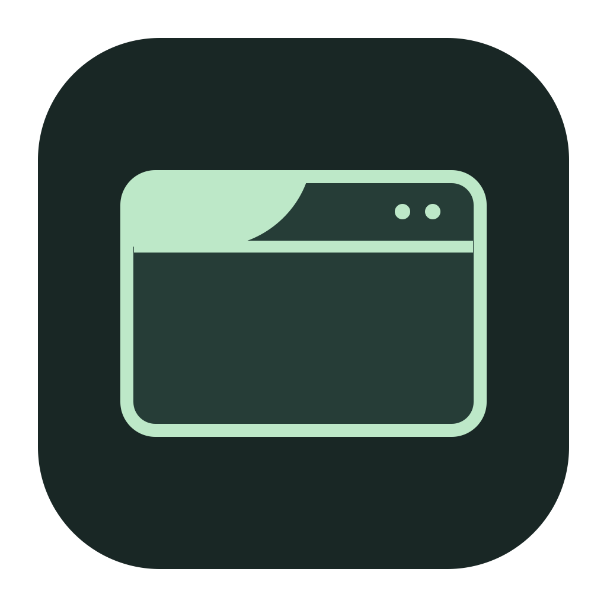
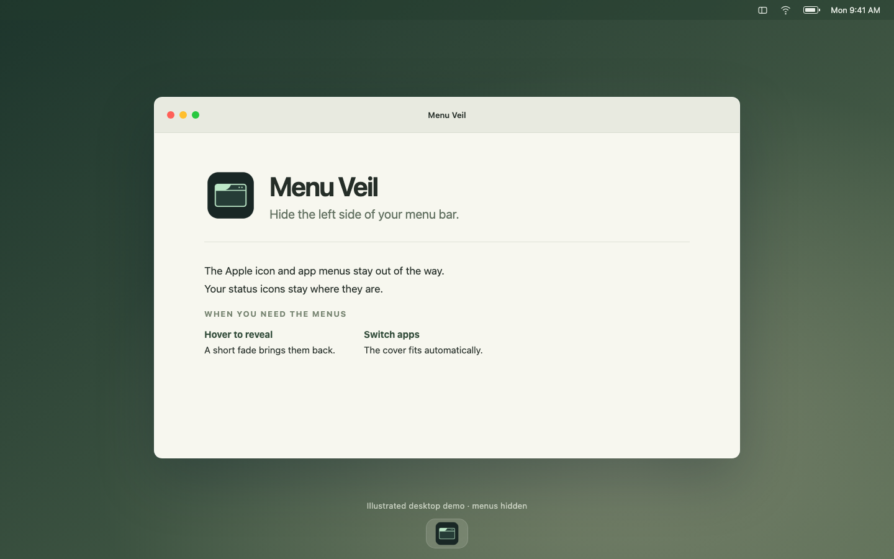

# Menu Veil



I wanted to hide the Apple icon and all the File, Edit, View stuff on the left, but keep the icons on the right. Couldn't find a macOS setting for that. So here's a small app that does it with a cover.

Hover over the left side and the menus fade back in. Move away and they're hidden again. The width follows whichever app you're using, so there's nothing to adjust manually.



This is an illustrated demo. Open `docs/demo.html` in a browser if you want to try the hover effect.

## Install

The first notarized release and Homebrew tap are being prepared. The command below is **not live yet**; it will be enabled when v0.2.0 is published:

```sh
brew install --cask frizurd/tap/menu-veil
```

Then open Menu Veil from Applications. The setup window walks you through three things: keep one installed copy, allow menu detection, and try hovering over the left menus.

On macOS 27, the permission is under System Settings → Privacy & Security → Device Control and Data Access. Earlier versions call it Accessibility. Menu Veil opens the permission page for you and checks when access becomes available.

Once it's running, look for the little rectangle icon on the right. That's where you can pause it, pick a background, show the menus for ten seconds, or quit. It doesn't add itself to your login items. Your pause, hover, and background settings are saved.

If permission is already on but the app can't read the menus, open **Setup & troubleshooting** from the rectangle icon. It shows which copy to add back to the permission list. That matters if you've used one of the earlier development builds.

## A few details

The app is written in Swift with AppKit. The cover is a window above the menu bar. Clicks go through it to the real menus underneath.

It measures when you switch apps or a supported menu notification arrives, with a three-second fallback while idle. While menus are revealed, it checks more often. That includes the Apple menu and greyed-out headings. The hover fade takes 0.2 seconds; hiding waits about half a second, then fades over 0.32 seconds. Opening a menu keeps it revealed. If you have Reduce Motion on, the fades are off.

For the cover background, it reads your wallpaper image. It doesn't record the screen or make network requests. There are no third-party dependencies.

## Things that still need work

I've only tried this on macOS 27.0.1 with one display. It works there, but I haven't checked older versions.

The menus are still underneath the cover, so you won't get extra room for status icons. And the background won't always match perfectly: animated wallpapers and the menu bar's tint can leave a seam. You can pick a solid background instead.

Multiple displays and full-screen apps still need more testing. It only covers the display whose menu bounds it actually measured, rather than copying a guessed width onto other displays.

To stop it, quit from the rectangle icon. The cover disappears straight away. You can turn its Accessibility permission back off in System Settings too.

## What happens when something goes wrong?

Permission missing, app not installed yet, Mac asleep, or menu bounds unavailable? The cover stays off. Old measurements expire after five seconds. A failed read removes the cover straight away, and late results from a previous app are ignored.

Opening another copy focuses the existing instance instead of creating another cover. Build-folder copies don't request permission, which helps avoid duplicate grants. Releases keep the same bundle ID and Developer ID signing identity; development builds can still need permission granted again after rebuilding.

The hover handler uses mouse events rather than a repeating 20 Hz timer. Mouse monitors are removed when paused, asleep, or waiting for permission. Wallpaper images are cached, and routine diagnostics are off. The app still does a low-frequency health check so it can recover when permission changes.

## Build from source

You'll need Xcode's command line tools:

```sh
zsh scripts/test.sh
zsh build.sh
```

This creates a development app in `build/`. Move it into Applications before normal use. The build supports Apple silicon and Intel, targeting macOS 14 or newer; runtime testing so far has been on macOS 27.0.1.

For release signing, notarization, and the Homebrew package, see [RELEASING.md](docs/RELEASING.md).
