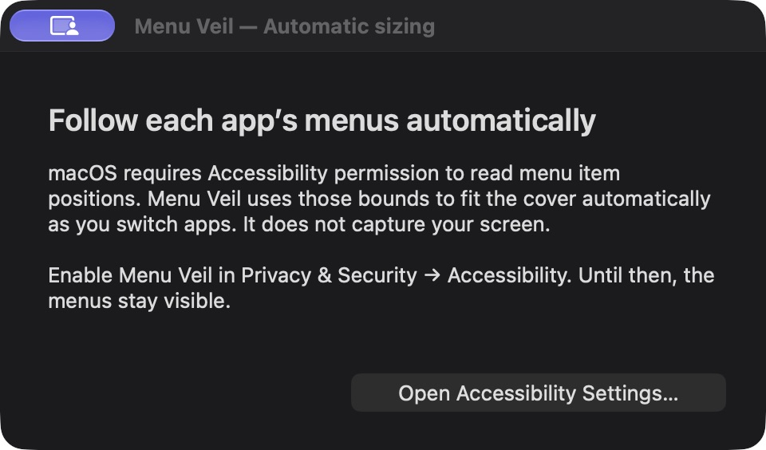

# Menu Veil

Hide the left side of your Mac's menu bar. Hover over it when you need it.

I wanted the Apple icon and the File, Edit, View menus out of the way, while keeping the status icons on the right. macOS only lets you hide the whole bar, so this app covers the left part.

The cover fits the active app's menus automatically. No width slider. Switch apps and it measures again. Hover over the menu area and the cover fades away; move away and it fades back.



## Try it

You'll need a Mac with the Xcode command line tools installed. Build it with:

```sh
zsh build.sh
open "build/Menu Veil.app"
```

On first launch, enable Menu Veil in System Settings → Privacy & Security → Accessibility. It needs that permission to read the menu positions. Until you allow it, the menus stay visible.

There's a small rectangle icon on the right side of the menu bar. Use it to pause the cover, change its background, reveal the menus for ten seconds, or quit. Nothing starts at login.

## How it works

It's a Swift/AppKit app with a window that sits over the menu bar and lets clicks pass through. It reads the active app's menu bounds through Accessibility, including the Apple menu and disabled headings. It checks again every 0.4 seconds and when you switch apps.

Hover fades the cover out in 0.2 seconds. After you leave for about half a second, it fades back over 0.32 seconds. It stays out of the way while a menu is open. Reduce Motion turns the fades off.

The background comes from your wallpaper image. No screen recording, network calls, or third-party dependencies.

## Still a prototype

Tested on macOS 27.0.1, on one display. Other versions haven't been checked.

This covers the menus visually. It doesn't remove them or make more room for status icons. Animated wallpapers and menu-bar tint can leave a visible seam. There are solid background options if the wallpaper doesn't match.

Mixed display sizes and full-screen apps still need testing. The measured width is reused on other displays, so those may need more work. Settings reset when you restart the app.

Quitting removes the cover straight away. If you want to remove its permission too, turn Menu Veil off in Accessibility settings.
